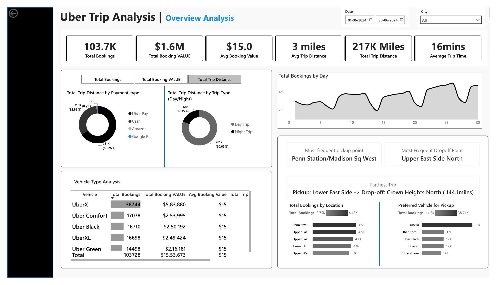
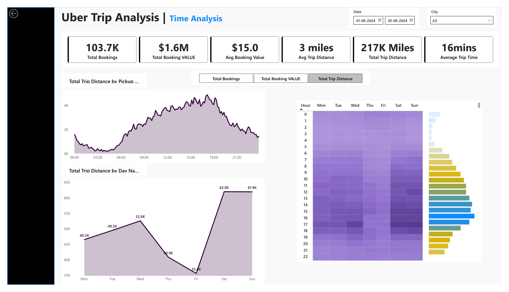
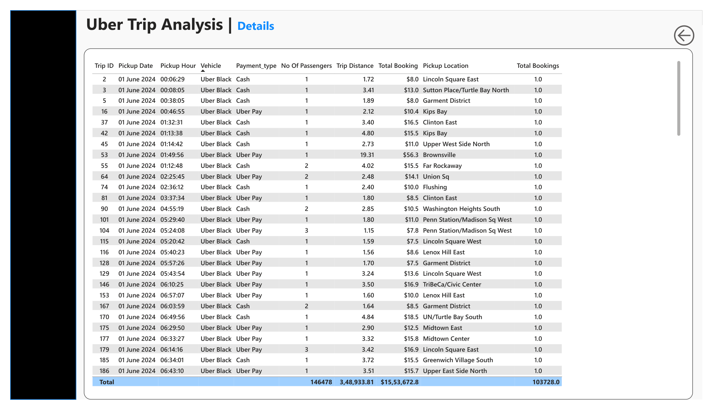

# Uber Trip Analysis | Power BI Dashboard

A three-page **Power BI trip analytics dashboard** examining booking activity, trip value, ride duration, travel distance, payment methods, vehicle categories, pickup/drop-off locations, and time-of-day patterns.

This repository currently documents the **report visuals only**. The Power BI `.pbix` file, source dataset, measures, and transformation code will be added separately. The images are static screenshots, not a live interactive dashboard.

## Dashboard preview

### 1. Overview Analysis



The overview page highlights **103.7K bookings**, approximately **$1.6M total booking value**, **$15 average booking value**, **3-mile average trip distance**, **217K miles total trip distance**, and **16-minute average trip time** for the selected June 2024 period. It includes vehicle categories, payment types, trip types, daily bookings, and pickup/drop-off location comparisons.

### 2. Time Analysis



The time page examines trip-distance patterns by pickup hour and day of the week, with an hourly/day-of-week matrix and interactive metric selection shown in the original report.

### 3. Trip Details



The details page provides a record-level trip table displaying pickup date/hour, vehicle, payment type, passengers, trip distance, booking value, and pickup location.

## Files

```text
uber-power-bi-analysis/
├── README.md
├── images/
│   ├── overview-analysis.png
│   ├── time-analysis.png
│   └── trip-details.png
└── reports/
    └── uber.pdf
```

## Tools and scope

- **Power BI Desktop** — report design and data visualization
- **Business intelligence** — booking and trip KPI analysis
- **Time-based analytics** — hourly and weekday trends

All displayed metrics are taken from the supplied PDF report. The underlying `.pbix` and source code are **not yet included**, so model relationships, DAX expressions, refresh behavior and data lineage cannot be verified from these screenshots alone.

## Author

**Neha Dudhane** — [GitHub](https://github.com/nehadudhane)
